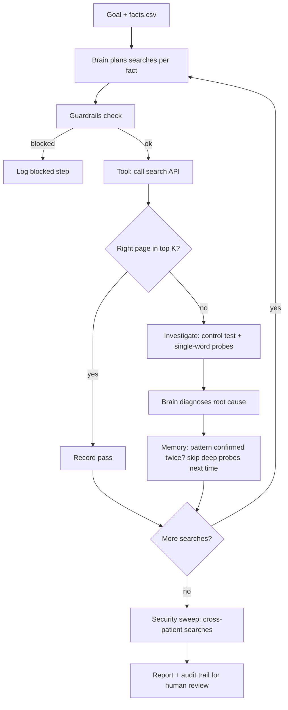

# Agentic layer for Smartrecord testing

An AI-style test AGENT that is given a GOAL (not a script) and decides its own searches, investigates failures, and reports with evidence.

    pip install -r requirements.txt
    python scripts/run_agent.py          # -> reports/agent_report.html, reports/agent_trace.json

## Files
| File | Role |
|---|---|
| `data/facts.csv` | What QA knows is on each page (from the synthetic test data). The agent's starting knowledge. |
| `agent/brain.py` | DECIDES: which searches to try, why something failed. `RuleBrain` = offline demo. `LLMBrain` = skeleton for a company-approved LLM (untested). |
| `agent/agent.py` | The LOOP: plan -> act -> observe -> investigate -> remember -> report |
| `agent/tools.py` | The only actions allowed: read-only search. Every call is traced. |
| `agent/guardrails.py` | Hard limits in code: call budget, host allow-list, PHI-pattern block |
| `agent/report.py` | HTML report + JSON audit trail |
| `scripts/run_agent.py` | Entry point + the goal text |

## Flow

## Swapping in an LLM
Set `BRAIN=llm`, `LLM_ENDPOINT`, `LLM_API_KEY`, `LLM_MODEL` in `.env` - ONLY for an endpoint your compliance team approved, and ONLY with synthetic facts. `LLMBrain` falls back to rules on any error. Untested skeleton: adjust payload/headers to your provider.
